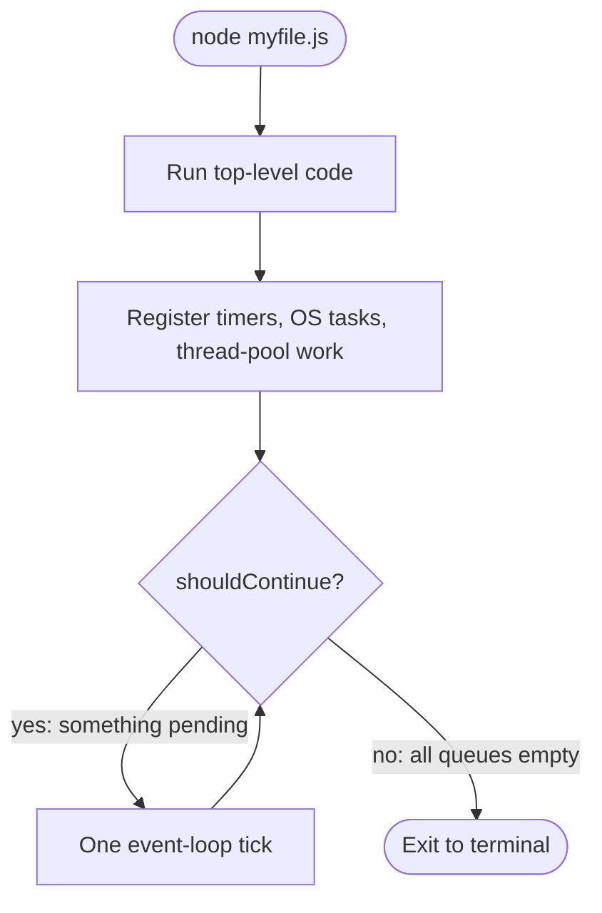
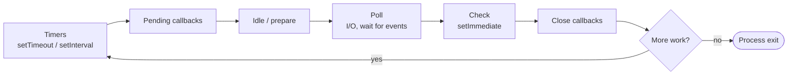
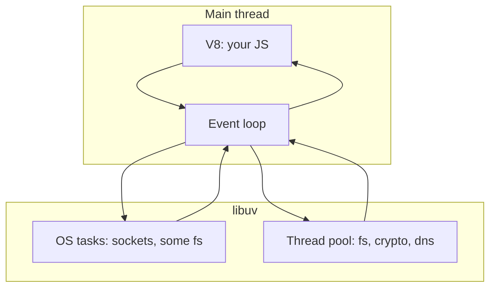

# Node internals: the event loop

Notes from `loop.js`. Node does **not** run your file and quit immediately. After `myfile.js` finishes, it keeps a loop alive while work is still pending.

## What `loop.js` is modeling

```js
myfile.runContent(); // your top-level code runs first

const pendingTimers = [];      // setTimeout, setInterval, setImmediate
const pendingOSTasks = [];     // OS / libuv work (sockets, some fs)
const pendingOperations = [];  // thread-pool work (dns, some fs, crypto)

function shouldContinue() {
  return (
    pendingTimers.length > 0 ||
    pendingOSTasks.length > 0 ||
    pendingOperations.length > 0
  );
}

while (shouldContinue()) {
  // one tick
}

// no pending work → process exits back to the terminal
```

Your file runs **once**. The `while` is Node itself, not something you write.

## When Node stays alive

| Queue in `loop.js` | Real examples | Why the process waits |
| --- | --- | --- |
| `pendingTimers` | `setTimeout`, `setInterval`, `setImmediate` | A callback is scheduled for later |
| `pendingOSTasks` | TCP server, open sockets | The OS still has a handle Node is watching |
| `pendingOperations` | `fs.readFile`, `crypto.pbkdf2`, some DNS | Work is in the libuv thread pool |

If all three are empty after your file (and after callbacks drain), Node exits.

## Diagram: process lifetime



## Diagram: one tick (simplified)

Inside that `while`, Node does not spin a busy loop. It waits, then runs **phases**.



Poll is the important pause: if there is I/O, Node waits there instead of burning CPU.

## How this maps to real Node

- **libuv** owns the loop, OS handles, and the thread pool (default 4 threads, `UV_THREADPOOL_SIZE`).
- **V8** runs your JavaScript. Callbacks from libuv are handed back to JS on the main thread.
- JS is **single-threaded**. Concurrent-looking I/O is the loop + thread pool, not extra JS threads.



## Tiny checks you can run

Stays alive (timer pending):

```js
setTimeout(() => console.log("tick"), 1000);
```

Stays alive (OS handle pending):

```js
require("http")
  .createServer((req, res) => res.end("ok"))
  .listen(3000);
```

Exits immediately (nothing pending):

```js
console.log("done");
```

## Preview this note

Open preview: `Cmd+Shift+V`  
Split editor + preview: `Cmd+K` then `V`
